# Draft metabolic maps from the BRENDA map

`ecmapper.draft_map` turns the matches of a model to the BRENDA map (see [README.md](README.md#finding-model-reactions-on-a-brenda-map))
into a draft map of the model: the subsystems of the BRENDA map that contain model reactions (without subsystems whose
model reactions are all drawn in other subsystems; those are set aside on a separate map), reduced to the enzyme
nodes with model reactions, completed with model reactions that connect drawn metabolites, condensed and arranged with
few crossings of the inter-pathway links, or (`--pack`) packed into as little space as possible without inter-pathway
links. The subsystem boxes and names are kept. With `--split`, the map is split into a central map and auxiliary
maps, one per BRENDA colour group, with an overview of the maps. Outputs: an SVG in the style of the
BRENDA map, an Escher map for editing, and box positions for CNApy.

The results for iML1515 are in [BRENDAmap/draft_map_iML1515](BRENDAmap/draft_map_iML1515).

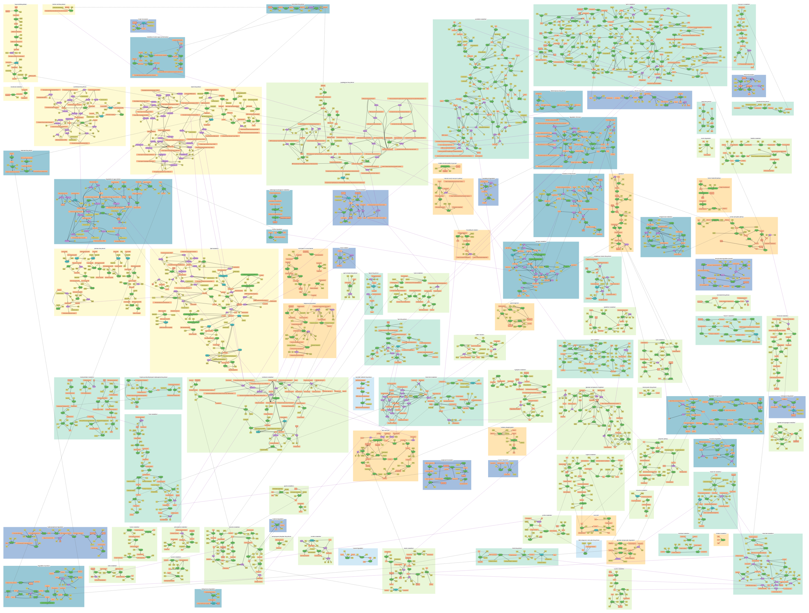

## Usage

```bash
python -m pip install -e "./ecmapper[draft-map]"   # numpy, scipy, numba, networkx, pygraphviz
cd ecmapper
# 1. match the model to the map (BiGG's SBML files have no subsystems: take them from the JSON file)
python -m ecmapper.draft_map.prepare iML1515.xml BRENDAmap/BRENDA_map_reactions.json iML1515_prep.pkl \
    --subsystems iML1515.json
# 2. build the draft map
python -m ecmapper.draft_map.run iML1515_prep.pkl BRENDAmap/BRENDA_map_reactions.json BRENDAmap/BRENDA_map.svg OUT \
    --hub-subsystems 6 --iterations 200000 --seed 3
# or without inter-pathway links, the subsystems packed into as little space as possible
python -m ecmapper.draft_map.run iML1515_prep.pkl BRENDAmap/BRENDA_map_reactions.json BRENDAmap/BRENDA_map.svg OUT_PACKED \
    --pack --iterations 200000 --seeds 4
# or split into a central map and auxiliary maps, each packed without inter-pathway links
python -m ecmapper.draft_map.run iML1515_prep.pkl BRENDAmap/BRENDA_map_reactions.json BRENDAmap/BRENDA_map.svg OUT_SPLIT \
    --split --pack --iterations 200000 --seeds 4
```

`iML1515.xml` and `iML1515.json` are from [BiGG](http://bigg.ucsd.edu/models/iML1515). The first step takes about
20 s with the resource files cached, the second two to three minutes. Options of `run`:

| Option | Default | |
|---|---|---|
| `--keep-subsets` | | keep subsystems whose model reactions are a proper subset of another subsystem's (rule A, step 1) |
| `--aside-coverage F` | 0.9 | set aside subsystems of which ≥ F of the model reactions are in other subsystems (rules B, C); 1: only fully covered ones, > 1: off |
| `--aside-min-matched F` | 0 (off) | set aside subsystems in which < F of the enzyme nodes have model reactions (rule D) |
| `--relayout` | `spring,fdp,dot,neato` | layouts tried in step 3b (see 1.3); `none`: keep the positions of step 3 |
| `--relayout-margin` | 0.25 | step 3b: `dot` and `neato` (which change the BRENDA drawing) need at least this fraction fewer crossings |
| `--min-anchored` | 2 | drawn main metabolites a model reaction needs to be added (step 3) |
| `--no-completion` | | skip step 3 |
| `--compactness` | 0.5 | weight of compactness against keeping the drawing when condensing (step 4) |
| `--hub-subsystems N` | 0 (off) | remove the inter-pathway links of metabolites drawn in at least N subsystems (step 5) |
| `--iterations`, `--seed`, `--seeds` | 20000, 1, 1 | annealing of the arrangement (step 6); with `--seeds k` the best of k runs is kept |
| `--gap` | 80 | space between subsystem boxes |
| `--flips {none,x,xy}` | none | allow mirroring subsystems (left–right, also upside down) |
| `--pack` | | instead of steps 5 and 6: drop the inter-pathway links and pack the subsystems into as little space as possible (see [3.4](#34-packed-without-inter-pathway-links---pack)); not with `--hub-subsystems`, `--flips`, `--compare-flips`, `--extra` |
| `--split` | | split into a central map and auxiliary maps, each arranged on its own (see [3.5](#35-split-into-a-central-map-and-auxiliary-maps---split)); not with `--compare-flips`, `--extra` |
| `--central IDS` | see 3.5 | with `--split`: comma-separated BRENDA subsystem IDs of the central map |
| `--maps FILE` | | with `--split`: JSON file `{map name: [BRENDA subsystem IDs]}` of further maps (before the central map; the other subsystems go to the map of their colour group) |
| `--min-map-reactions` | 25 | with `--split`: colour group maps with fewer model reactions are merged into the map they have most links with |
| `--escher-scale` | 2.5 | scale of the Escher map relative to the BRENDA map |
| `--escher-no-labels` | | no subsystem names in the Escher map |
| `--escher-straight` | | straight segments in the Escher map, further reactions of an enzyme node below the first (default: straight reaction axes and curved branches, see [5](#5-escher-export)) |
| `--compare-flips`, `--extra graphviz elk user-order` | | further arrangements for comparison (`map_*.svg`, `stats.json`); Graphviz needs pygraphviz, ELK needs `node` with `elkjs` on `$NODE_PATH` |

Outputs in `OUT`:

| File | |
|---|---|
| `draft_map.svg` | the draft map in the style of the BRENDA map; reaction IDs below the enzyme nodes, model reactions in the tooltips |
| `draft_map.escher.json` | Escher map (see [Escher export](#5-escher-export)) |
| `draft_map.maps` | CNApy box positions `{reaction ID: [x, y]}` for `draft_map.svg` as background |
| `set_aside.svg`, `.escher.json`, `.maps`, `.reaction_positions.json` | the subsystems set aside in step 1 (see 1.1), on a map of their own |
| `reaction_positions.json` | positions of the enzyme nodes of each drawn model reaction |
| `added_reactions.json` | the model reactions added in step 3, with subsystem, position and drawn metabolites |
| `step1_subsystems.svg`, `step2_pruned.svg`, `step3_completed.svg`, `step3b_relayout.svg` | the map after steps 1–3b (original arrangement) |
| `map_*.svg` | the arrangements compared |
| `stats.json` | counts after each step, hub metabolites, metrics of the arrangements, coverage of the model |
| `draft_map.pkl` | the final `DraftMap` |

With `--split`, `OUT` has instead of the `draft_map.*` files, for each map (file prefix: the map name in lower case,
e.g. `central_metabolism`): `<map>.svg`, `<map>.escher.json`, `<map>.maps`, `<map>.reaction_positions.json`,
`<map>.pkl` (the set-aside subsystems are the last map, `set_aside`); and `overview.svg` (the overview, see 3.5; the map names link to the SVGs), `maps.json` (the subsystems
and model reactions of each map, the metabolites linked across maps) and `stats.json` (per map in `maps`).

Enzyme nodes: green: model reaction on the map; cyan: found in the vicinity search; violet, dashed: added from the model
(step 3). Metabolite nodes added in step 3 are dashed, hub metabolites (step 5) have a red border. Inter-pathway links
are dashed grey lines (purple: added in step 3).

`scripts/svg_to_png.js` renders an SVG (or a part of it) as PNG, `scripts/render_escher.js` loads an Escher map with a
model in Escher, saves a screenshot and reports reactions and metabolites missing in the model (both need playwright).

## 1. Method

| Step | What | How |
|---|---|---|
| 0 | Match the model to the map | `prepare`: `MapMatcher` (vicinity search `propagate`); stores the matches, the keys of model and map metabolites, the reactions with stoichiometry, direction, genes and subsystem |
| 1 | Drop subsystems without model reactions; drop or set aside redundant ones | see 1.1 |
| 2 | Remove enzyme nodes without model reactions | also the metabolite nodes that only they use; inter-pathway links through removed metabolite nodes are bridged |
| 3 | Complete the network with model reactions that are not on the map | see 1.2 |
| 3b | Lay out the subsystems with added reactions again | networkx and Graphviz layouts, the one with the fewest crossings is kept, see 1.3 |
| 4 | Condense each subsystem | order-preserving LP compaction, see 1.4; box and title fitted around the drawing |
| 5 | Disconnect hub metabolites | the inter-pathway links of metabolites drawn in ≥ N subsystems are removed; their nodes stay and are marked |
| 6 | Arrange the subsystems with few crossings of inter-pathway links | simulated annealing over sequence pairs, see 1.5 |
| 7 | Output | SVG, Escher map, CNApy box positions, reaction positions |

The subsystems are arranged last, although the original idea was to arrange them right after dropping the empty
ones: the arrangement needs the final box sizes and the positions of the linked metabolites in the boxes, and both
change with pruning, completion and condensation. Arranging first and condensing afterwards (`--extra user-order`)
ends with 1.6× the crossings (276 vs. 173 for iML1515) and a 23% larger area, because the boxes shrink after the
arrangement was optimised.

With `--pack`, the inter-pathway links are removed after step 4 and steps 5 and 6 are replaced by a packing of the
boxes: the annealing of 1.5 without links, which leaves only the area and the aspect ratio in the cost. Before step 4,
the few edges of the BRENDA map from an enzyme node to a metabolite node in another subsystem are made local (they
would cross the packed boxes): the edge is removed if the enzyme node has the metabolite in its own subsystem,
otherwise the metabolite gets a copy next to the enzyme node.

With `--split`, the edges are made local as for `--pack`, and after step 4 the subsystems are assigned to maps and
steps 5 and 6 run for each map; see [3.5](#35-split-into-a-central-map-and-auxiliary-maps---split).

Set-aside subsystems (1.1) go through steps 2 and 4 like the others but are not used by the completion (step 3); after
step 5 they are moved to a map of their own (with `--split`: the last map), arranged like the main map. Links between
them and the main map become references as with `--split`.

Inter-pathway links considered: the BRENDA `inter-pw-link`s (same compound in two subsystems, hidden in the BRENDA
SVG) whose both ends are main metabolites of enzyme nodes with model reactions, plus the links added in step 3.

### 1.1 Redundant subsystems (step 1)

The BRENDA map draws some steps in several subsystems, so some subsystems only repeat model reactions that are
drawn elsewhere (e.g. "photosynthesis" repeats the Calvin cycle steps of glycolysis and the pentose phosphate
pathway). With the model reactions of a subsystem being those of its enzyme nodes after step 1:

| Rule | Subsystems | Action | Option |
|---|---|---|---|
| A | model reactions are a proper subset of those of one other subsystem | removed | `--keep-subsets` turns it off |
| B | all model reactions are also in the other remaining subsystems | set aside | `--aside-coverage 1` (only B) |
| C | ≥ 90% of the model reactions are also in the other remaining subsystems | set aside | `--aside-coverage 0.9` |
| D | < F of the enzyme nodes have model reactions | set aside | `--aside-min-matched F`, off by default |

B and C go through the subsystems from the smallest (fewest model reactions; ties by ID) and compare each with the
subsystems not yet set aside, so of two subsystems with the same reactions one stays. The set-aside subsystems are
drawn on a separate map, from which they can be copied back. A model reaction drawn only in set-aside subsystems (rule
C) is a candidate of the completion (step 3) and may be added to the main map.

Rule D is off because the fraction of matched enzyme nodes does not tell redundant subsystems from real ones: the
BRENDA subsystems are generic, so for iML1515 tryptophan (16%) and lysine metabolism (18%) have lower fractions than
photosynthesis (50%).

### 1.2 Completion with model reactions (step 3)

Candidates: model reactions not on the map, without boundary reactions and transporters (as ecmapper defines them),
whose main metabolites (no currency metabolites, carriers such as ACP, thioredoxin, quinones, protons) are in one
compartment. A drawn metabolite node "is" a model metabolite if it is a main metabolite of an enzyme node whose model
reaction contains the metabolite with a common key (KEGG compound, normalised name), as in ecmapper's matching.

- A candidate is added if ≥ 2 (`--min-anchored`) of its main metabolites are drawn, at least one of them by a node
  of the map (not only by a node added for an earlier candidate). Repeated until nothing changes. So reactions close
  gaps between drawn metabolites or extend the map by one step; chains far away from the map are not built (without
  this condition, 205 reactions, mostly lipid chain variants, piled up in purine metabolism for iML1515).
- Subsystem: the one with most of the reaction's drawn main metabolites; ties: the subsystem of the reaction's best
  `related` node (same EC number or reaction ID, other metabolites), the BRENDA subsystem in which most model
  reactions of the same model subsystem are drawn, the nearest subsystem.
- Position: the removed `related` node of the map if there is one in that subsystem, otherwise between the drawn
  metabolites (free place by spiral search). Main metabolites drawn only in other subsystems get a new node, linked
  to the nearest drawn node (an inter-pathway link); metabolites not on the map get a new node; cofactors get
  cofactor nodes. Arrows follow the model's reversibility.
- Variants (same drawn nodes, reaction or new metabolite IDs equal apart from digits, e.g. chain lengths
  `PLIPA2E160pp`, `PLIPA2E161pp`) share one node labelled `PLIPA2E160pp (+1)`.

### 1.3 Layout of subsystems with added reactions (step 3b)

The completion places added reactions between their drawn metabolites; where many reactions are added (e.g. the
phospholipid turnover in lipid A biosynthesis), this gives long edges that cross the drawing. Step 3b lays out each
subsystem with added reactions again with four layouts of its enzyme and main metabolite nodes (an enzyme node with
its cofactors counts as one box, the cofactors keep their offsets):

| Layout | Package | Keeps the BRENDA drawing |
|---|---|---|
| `spring`: Fruchterman–Reingold spring layout of the added nodes, the nodes of the BRENDA map fixed | networkx | yes |
| `fdp`: the same with Graphviz `fdp`, the BRENDA nodes pinned | pygraphviz | yes |
| `dot`: Graphviz `dot`, layered (Sugiyama) along the reaction directions | pygraphviz | no |
| `neato`: Graphviz `neato` (stress majorisation), all nodes free, starting from the current drawing | pygraphviz | partly |

Each layout (and the current drawing) is condensed as in step 4 and the one with the fewest crossings of
main-metabolite links is kept (ties: crossings of all links, area). `dot` and `neato`, which change the BRENDA drawing,
are only taken if they have at least 25% (`--relayout-margin`) fewer crossings than the best of the current drawing,
`spring` and `fdp`. `--relayout` selects the layouts (`none`: skip the step); layouts whose package is missing are
skipped.

pygraphviz 2.0 and later ships Graphviz in its wheels (Linux, macOS, Windows), so `pip install pygraphviz` needs no
system Graphviz and no compiler. Three Graphviz details matter: `neato` and `fdp` read input positions in inches
(`inputscale=72` for points); `overlap=false` removes overlaps and then moves pinned nodes too (`overlap=true`, step 4
removes overlaps); and `fdp` keeps state between layouts in a process, so later `fdp` layouts in a process vary between
runs. Each Graphviz layout therefore runs in a process of its own (`graphviz_worker.py`, four at a time), which makes
the step reproducible; it takes about 25 s for iML1515.

### 1.4 Condensing a subsystem (step 4)

Alternating x/y 1D compaction solved as an LP (scipy, HiGHS): nodes whose extents overlap in the other axis keep their
order with a minimum gap; nodes closer than 150 units in the other axis keep their order; objective
Σ|pᵢ − s·pᵢ⁰| + 0.5·n·extent, i.e. a uniform shrink by a factor s plus individual moves that close larger holes.
This is the idea of VPSC/PRISM overlap removal (keep the relative layout, remove space). For iML1515, free
compaction (no order band) gave −52% area but +20% crossings of main-metabolite links inside the subsystems; full order
preservation −29% area, +3% crossings; the band of 150 −44% area, +8% crossings.

### 1.5 Arrangement of the subsystems (step 6)

The subsystems are fixed boxes with "ports" (the linked metabolite nodes inside them). An arrangement is encoded as a
sequence pair (Murata et al. 1995, VLSI floorplanning), which always gives an overlap-free, packed placement.
Simulated annealing (numba kernels, 1.5–2.5 minutes for 200,000 moves with about 100 subsystems) minimises

`crossings + 0.5·link–box crossings + 0.02·link length/mean box size + 100·area/Σ box area + 200·log(aspect/1.6)²`

with moves: swap two boxes in one sequence, exchange the places of two boxes, optionally mirror a box. It starts from
the original BRENDA arrangement.

## 2. Layout tools

Arrangement of the subsystem boxes (step 6) and compaction (step 4):

| Tool | Fit for this task | Tried |
|---|---|---|
| **Sequence-pair annealing** (here, Python and numba) | Optimises exactly the wanted objective (crossings of links between fixed drawings with fixed ports, link–box crossings, area); keeps the drawings of the subsystems | yes – used |
| **scipy / HiGHS LP** | Order-preserving compaction (VPSC-like) of nodes and boxes | yes – used |
| Graphviz `neato`/`fdp`/`sfdp` (+ VPSC overlap removal) | Places boxes by stress/forces on the box graph; ignores ports, no crossing objective. `prism` overlap removal needs GTS (not in Ubuntu's build nor in the pygraphviz wheels) | yes – 2.3× (neato) to 5.5× (fdp) more crossings |
| ELK (elkjs) `layered` with `FIXED_POS` ports | Sugiyama with real crossing minimisation and fixed port positions, but forces a layered flow; large area. Its orthogonal/polyline edge routing (and libavoid in ELK) is useful for routing inter-pathway links | yes – 4.4–6× more crossings |
| ELK `stress`, `rectpacking` | stress ignores sizes and ports; rectpacking packs boxes without edges | stress – poor |
| OGDF (C++, `ogdf-python`) | Strongest library for crossing minimisation (planarisation, cluster planarity, orthogonal layouts); does not keep given drawings, could arrange the box graph | not for the boxes (see below for subsystems) |
| Tulip (used by CBMViz in this repository) | Bundles OGDF layouts and graph hierarchies, scriptable in Python; tulip-python needs Tulip binaries, which are no longer provided | no |
| adaptagrams (libcola, libvpsc, libavoid) / WebCola | Constraint-based layout with alignment/separation constraints, VPSC overlap removal and libavoid object-avoiding connector routing: best candidate for routing inter-pathway links around boxes and for alignment constraints inside subsystems | no |
| Cytoscape.js `fcose` / Cytoscape (yFiles layouts) | Compound nodes (subsystems) with constraints; yFiles (commercial, free in yEd) has the best grouped hierarchical/orthogonal layouts | no |
| igraph / networkx | No boxes or ports for the arrangement | no |
| Metabopolis (Wu et al. 2019) | Published method closest to this scheme: pathways as blocks, inter-pathway links minimised, orthogonal routing in channels ("urban map") | no implementation available |
| Escher | Editing target (no automatic layout); its builder draws a new reaction along a straight axis with Bezier curves to the metabolites | export, in the builder's drawing style (section 5) |
| BioEMMA (KEGG KGML → Escher) | Puts the multimarkers on a straight reaction axis a fraction of the way to the main metabolites and the secondary metabolites next to them; straight segments (version 0.4.3 on PyPI) | code read; its multimarker placement is used in the Escher export |

Layout inside the subsystems with added reactions (step 3b): the 59 subsystems of iML1515 with added reactions, each
laid out after step 3 and condensed as in step 4; crossings of main-metabolite links / of all links, sum of the box
areas:

| Tool (install) | Layout | Crossings | Box area |
|---|---|---|---|
| – | current (step 3) | 1,112 / 1,717 | 63 M |
| **networkx** (pip, pure Python) | **spring, BRENDA nodes fixed** | 396 / 732 | 61 M |
| **Graphviz via pygraphviz** (pip, Graphviz included) | **`fdp`, BRENDA nodes pinned** | 460 / 713 | 60 M |
| | `neato` / `neato` Kamada–Kawai, pinned | 864 / 1,692, 653 / 1,303 | 69 M |
| | **`dot`** (Sugiyama) top-down / left-right | 471 / 734, 574 / 920 | 78 M, 74 M |
| | **`neato`, free, starting from the current drawing** | 327 / 681 | 74 M |
| | `sfdp`, free | 400 / 840 | 71 M |
| OGDF via `ogdf-python[quickstart]` | Sugiyama (optimal ranking, median heuristic, optimal hierarchy layout) | 518–529 / 820–839 (two runs) | 71–72 M |
| igraph (pip) | `layout_sugiyama` (no node sizes) | 2,065 / 2,740 | 69 M |
| grandalf (pip, pure Python) | Sugiyama | 904 / 1,358 | 72 M |
| networkx | Kamada–Kawai, ForceAtlas2, ARF (all nodes free) | more crossings than spring; disconnected parts drift apart | |

The layouts are complementary: per subsystem the best of the four layouts in bold (with the 25% margin for `dot` and
free `neato`, see 1.3) gives 242 crossings in this comparison, 245 in the pipeline. OGDF's Sugiyama layout (the one
CBMViz uses through Tulip) is no better than Graphviz `dot` here and harder to install: `ogdf-python` builds two cppyy
packages from source (7 minutes, needs a C++ compiler; 140 MB of wheels), and objects passed to OGDF must not be freed
by Python (segmentation faults otherwise). Sugiyama layouts route long edges with bends, which the straight edges of
the SVG and the Escher map do not show.

## 3. Results on iML1515

Input: iML1515 from BiGG, matched with vicinity search `propagate`: 714 of 2,375 non-boundary reactions are on 815 of
2,848 enzyme nodes in 115 of 193 subsystems.

Redundant subsystems (1.1): rule A removed 11 subsystems with 1–2 model reactions each (e.g. CDP-diacylglycerol
biosynthesis ⊂ lipid metabolism, glycogen biosynthesis ⊂ degradation of hexoses, ornithine metabolism ⊂ acetate
fermentation, tropane alkaloid biosynthesis ⊂ polyamine pathway). Rule B set aside acetyl-CoA biosynthesis (the same
reaction as the oxidative decarboxylation of pyruvate, PDH), butanoate fermentation, aerobic toluene degradation,
C4 and CAM carbon fixation and the methylaspartate cycle; rule C photosynthesis (12 of 13 reactions in glycolysis,
gluconeogenesis and the pentose phosphate pathway; the 13th, `FBA3`, is added by the completion, see 4). The
[set-aside map](BRENDAmap/draft_map_iML1515/set_aside.svg) has these 6 subsystems with 38 model reactions:

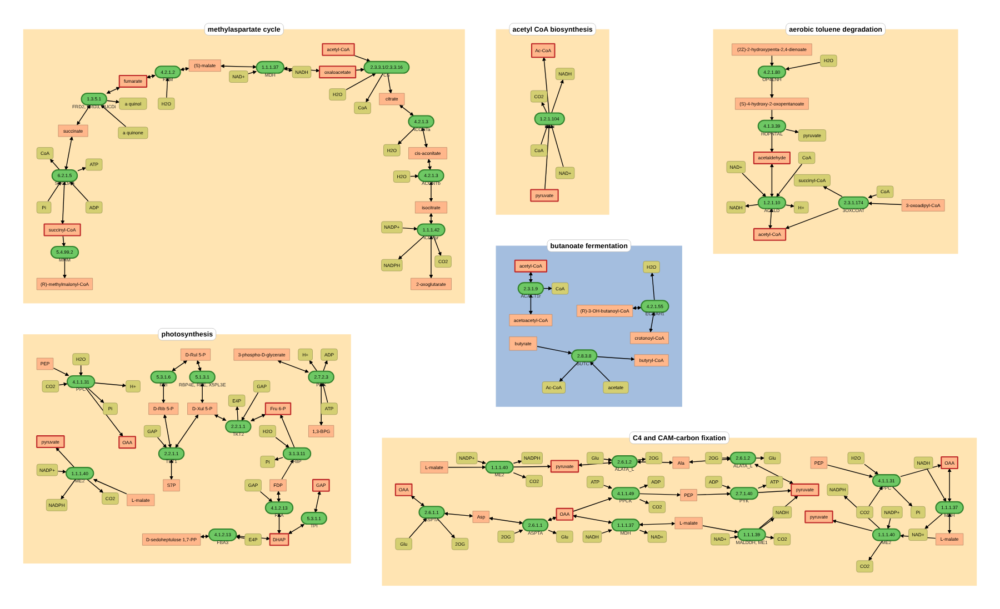

### 3.1 Map after each step

| | subsystems | enzyme nodes | main metabolite nodes | cofactor nodes | model reactions | inter-pathway links |
|---|---|---|---|---|---|---|
| BRENDA map | 193 | 2,848 | 2,818 | 6,257 | – | 234 |
| step 1, subsystems with model reactions | 115 | 1,943 | 1,876 | 4,138 | 714 | 161 |
| step 1, rules A–C (6 set aside) | 104 | 1,841 | 1,759 | 3,910 | 714 | 151 |
| step 2 | 104 | 800 | 941 | 1,603 | 714 | 109 |
| step 3 | 104 | 1,073 | 1,196 | 1,969 | 1,010 | 205 |
| step 5 (hubs ≥ 6), without the set-aside subsystems | 98 | 1,033 | 1,144 | 1,891 | 1,010 | 150 |

Step 3 added 297 of 791 candidate reactions on 273 enzyme nodes, 159 nodes of metabolites not on the map and 96
linked nodes of metabolites drawn in other subsystems. 217 of them connect 2 metabolites that were already drawn,
76 connect 3–5.

Step 3b laid out the 59 subsystems with added reactions again and kept the current drawing in 7, `spring` in 15,
`fdp` in 15, `dot` in 12 and `neato` in 10 of them. Crossings of main-metabolite links in these subsystems (after
condensing): 1,112 → 245 (−78%), e.g.:

| Subsystem | added / all enzyme nodes | without step 3b | with step 3b | layout kept |
|---|---|---|---|---|
| arachidonate biosynthesis | 18 / 23 | 78 | 20 | `fdp` |
| lipid A biosynthesis | 29 / 40 | 114 | 43 | `spring` |
| lipid metabolism | 20 / 48 | 97 | 17 | `neato` |
| vitamin B12 metabolism | 15 / 23 | 191 | 63 | `spring` |
| purine metabolism | 8 / 77 | 73 | 7 | `fdp` |

| Without step 3b (lipid A biosynthesis, arachidonate biosynthesis) | With step 3b |
|---|---|
| 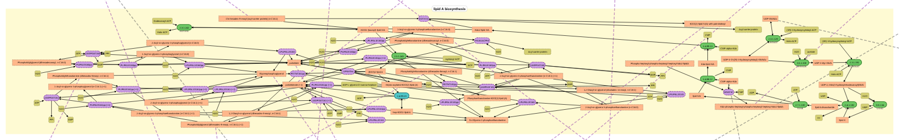 | 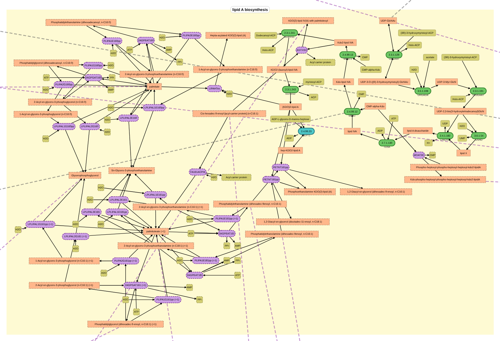 |
| 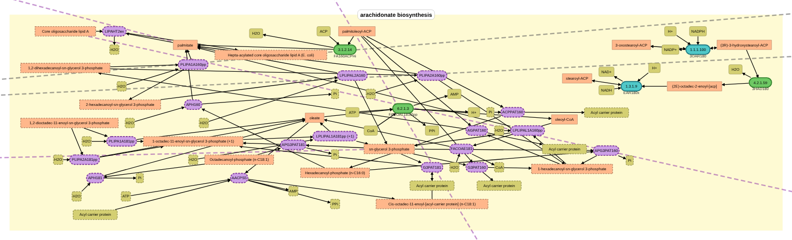 | 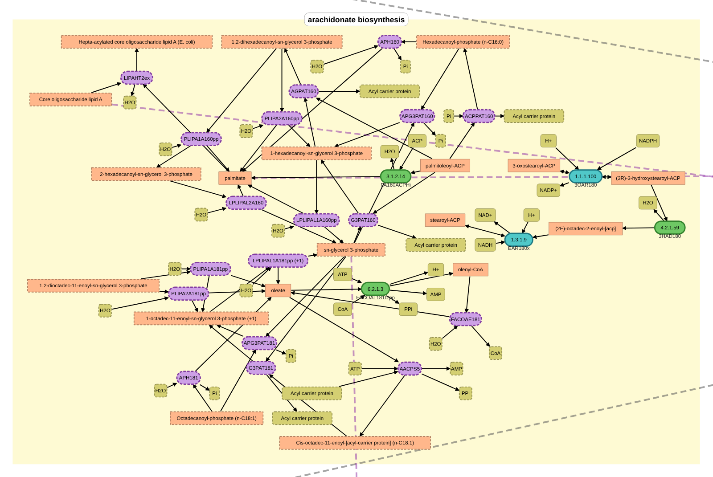 |

Step 4 (sum over the subsystems; in parentheses without step 3b):

| | before | after |
|---|---|---|
| drawing area | 147.0 M units² (115.1 M) | 70.7 M, −52% (64.7 M) |
| overlapping nodes | 28 (7) | 0 |
| crossings of main-metabolite links inside subsystems | 221 (1,029) | 245, +11% (1,112) |
| crossings of all links (incl. cofactors) | 374 (1,466) | 482, +29% (1,727) |

Coverage: 2,712 reactions = 337 boundary + 768 transporters + 1,607 others; the draft map shows 1,010 of the 1,607
(63%; 713 from the map, 297 added; the same reactions as without rules A–C). By model subsystem e.g. citric acid cycle 14/14, pentose phosphate pathway 12/12,
glycolysis/gluconeogenesis 20/23, histidine 10/10, cysteine 12/14; glycerophospholipid metabolism 74/246 (chain-length
variants), murein recycling 8/33, murein biosynthesis 0/15, "Transport, Inner Membrane" 1/23.

### 3.2 Hub metabolites

Metabolites drawn in ≥ 6 of the remaining subsystems (subsystems / inter-pathway links): pyruvate 24/7, acetyl-CoA
19/9, GAP 12/4, F6P 8/6, L-serine 8/6, oxaloacetate 8/3, DHAP 8/2, chorismate 7/5, L-glutamate 7/2, GTP 6/4,
fumarate 6/3, succinyl-CoA 6/3, acetaldehyde 6/1 — 55 of 205 links.

### 3.3 Arrangements

Inter-pathway link crossings / link–box crossings / area ÷ Σ box area; seed 1, 200,000 moves
([arrangement_experiments.json](BRENDAmap/draft_map_iML1515/arrangement_experiments.json); its `fin_hub*` entries are
the runs with 4 seeds, `x`: with left–right mirroring). These comparisons were made before rules A–C, with all 115
subsystems:

| hubs disconnected | links | original order, compacted | **annealed** | annealed, mirrored (x, y) | arrange, then condense | Graphviz neato | Graphviz fdp | ELK layered | ELK stress |
|---|---|---|---|---|---|---|---|---|---|
| none | 212 | 1321 / 313 / 2.77 | **449 / 184 / 2.20** | 360 / 166 / 2.10 | 706 / 257 / 3.13 | 1863 / 595 / 3.89 | 1625 / 1018 / 2.69 | 2084 / 586 / 3.06 | 1827 / 790 / 3.90 |
| ≥ 8 subsystems (7) | 174 | 984 / 264 / 2.77 | **223 / 117 / 1.89** | 148 / 90 / 1.95 | 360 / 173 / 2.57 | 908 / 530 / 3.24 | 1114 / 779 / 2.84 | 983 / 282 / 3.85 | 1190 / 673 / 4.35 |
| ≥ 6 subsystems (14) | 153 | 880 / 236 / 2.77 | **173 / 82 / 2.07** | 126 / 91 / 2.16 | 276 / 145 / 2.54 | 813 / 422 / 3.10 | 889 / 634 / 2.76 | 1040 / 270 / 2.56 | 806 / 620 / 3.48 |
| ≥ 5 subsystems (21) | 139 | 752 / 216 / 2.77 | **102 / 69 / 1.96** | 90 / 68 / 1.88 | 223 / 114 / 2.35 | 496 / 320 / 3.35 | 780 / 706 / 2.52 | 529 / 193 / 3.37 | 536 / 322 / 4.20 |

The Graphviz columns use Graphviz's default edge lengths; `--extra graphviz` sets them from the box sizes, which gives 406 / 145 / 2.32 (neato) and 950 / 701 / 2.65 (fdp) for hubs ≥ 6. Over 4 seeds (hubs ≥ 6): 148–173
crossings without mirroring, 121–138 with left–right mirroring.

Final map (98 subsystems after rules A–C, step 3b): hubs ≥ 6, no mirroring, seed 3: **162 crossings (−83% vs. 942
in the original order), 83 link–box crossings (−68% vs. 256), area 1.71 × Σ box areas (original order: 2.69), 13,820 ×
9,950 units**. Without step 3b, the same settings gave 153 crossings, 91 link–box crossings and 15,550 × 9,370 units;
with all 115 subsystems (no rules A–C, no step 3b) 149 crossings, 87 link–box crossings and 15,870 × 9,350 units.

| Original arrangement, compacted | Draft map: glycolysis, pentose phosphate and Entner–Doudoroff pathways |
|---|---|
| 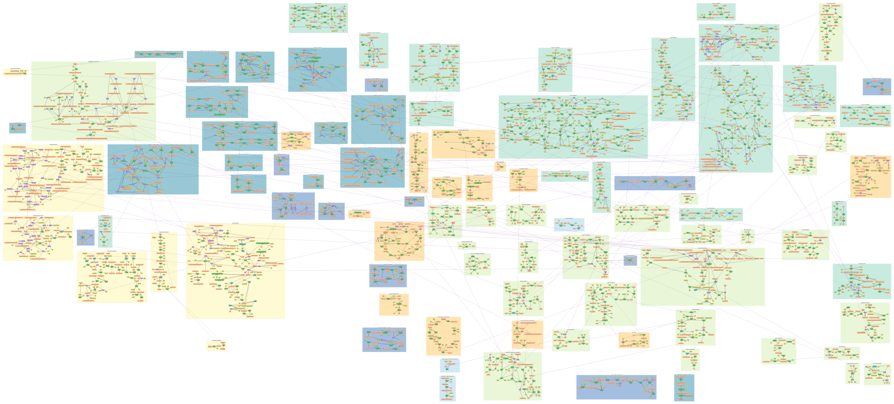 | 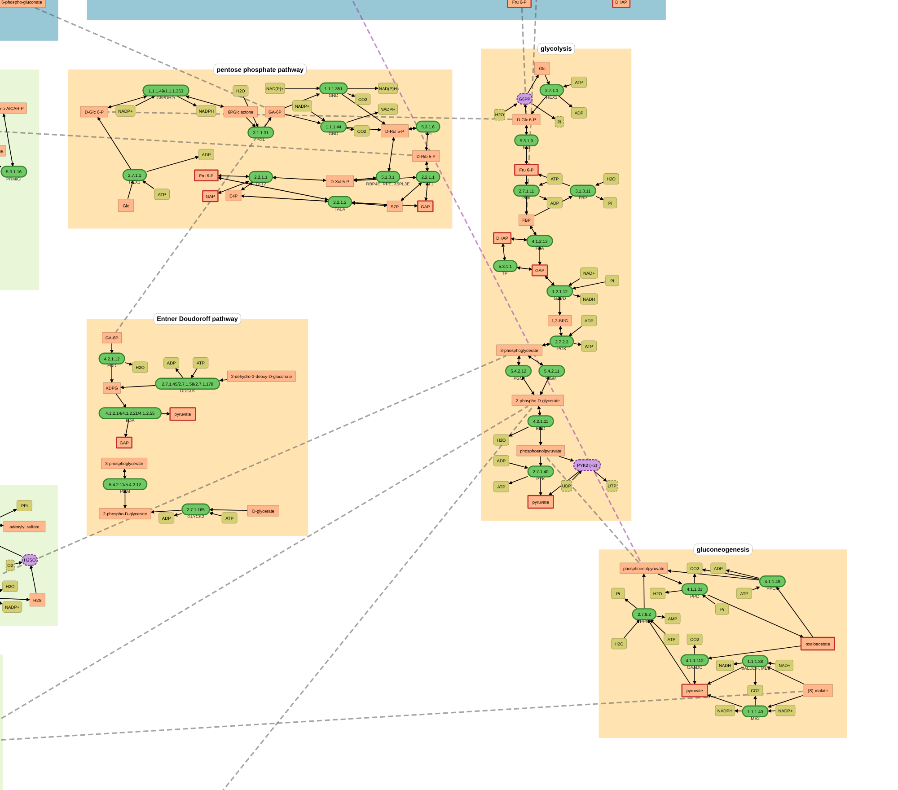 |

### 3.4 Packed without inter-pathway links (`--pack`)

[BRENDAmap/draft_map_iML1515/packed](BRENDAmap/draft_map_iML1515/packed): 200,000 moves, 4 seeds (area 1.223–1.233 ×
Σ box areas, about 15 s per seed). One edge of the BRENDA map crosses subsystems for iML1515 (sarcosine oxidase in
creatinine degradation to glycine in threonine metabolism; removed, glycine is drawn in creatinine degradation too).

| | width × height (units) | area ÷ Σ box area |
|---|---|---|
| original order, compacted | 23,955 × 9,019 | 2.69 |
| arranged for few crossings (hubs ≥ 6, the map of 3.3) | 13,819 × 9,946 | 1.71 |
| **packed** | **12,644 × 7,758** | **1.22** |

The packed map needs 29% less area than the map arranged for few crossings and 55% less than the original order
(`--gap`, 80 units between the boxes, makes it smaller still). The packing does not consider which subsystems belong
together: glycolysis, gluconeogenesis, the pentose phosphate pathway and the citric acid cycle are spread over the map.
The map has the same subsystems, nodes and reactions as the map of 3.3, and the same set-aside map; its Escher map
passes the same checks.

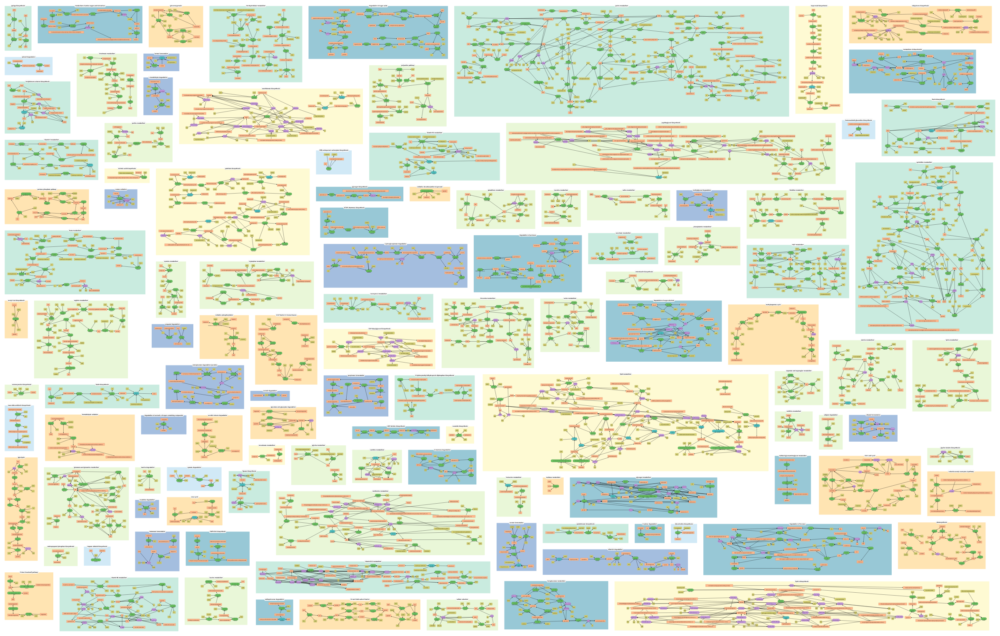

### 3.5 Split into a central map and auxiliary maps (`--split`)

Maps for genome-scale models get large. `--split` makes a central map and auxiliary maps, each a draft map of its own,
and an overview:

- **Central map:** the subsystems of `--central`, by default glycolysis, gluconeogenesis (with the anaplerotic
  reactions), the pentose phosphate and Entner–Doudoroff pathways, the oxidative decarboxylation of pyruvate, the
  citric acid cycle (with the glyoxylate shunt), oxidative phosphorylation and the acetate, ethanol and lactate
  fermentations.
- **Auxiliary maps:** one per colour group of the BRENDA map (the colours of the subsystem boxes), named after their
  subsystems: energy and C1 metabolism (`pw1` without the central subsystems), lipids (`pw2`), amino acids (`pw3`),
  nucleotides and cofactors (`pw4`), carbohydrates (`pw5`), fermentation and degradation (`pw6`), other pathways
  (`pw7`, `pw0`). Maps with fewer than `--min-map-reactions` model reactions are merged into the map they have most
  inter-pathway links with. `--maps` defines further maps.
- **References:** an inter-pathway link between two maps is replaced by a label "→ map names" below both ends, in
  the SVG and as an Escher text label. The references are made from all links, those of hub metabolites included;
  `--hub-subsystems` then removes the hub links inside the maps before arranging them.
- **Set-aside subsystems** (1.1) are the last map, "Set aside".
- **Arrangement:** each map is arranged as in 3.3, with its own links (with `--pack`: packed without links).
- **Overview** (`overview.svg`): one region per map, each subsystem collapsed to a small box with its number of model
  reactions; the boxes keep the relative order they have on their map (sequence pair of their centres, packed). The
  regions are arranged with few crossings of the links between maps (annealing as in 1.5). Grey lines: links inside
  a map, purple: between maps (width by the number of links, hub links left out).

[BRENDAmap/draft_map_iML1515/split](BRENDAmap/draft_map_iML1515/split): `--split --pack`, 200,000 moves, 4 seeds
per map (about 5 minutes). "Other pathways" (7 reactions) was merged into amino acids. 117 inter-pathway links
between maps became references on 209 metabolite nodes (85 metabolites); the links inside the maps are dropped, as
they add little once the maps are small.

| Map | Subsystems | Model reactions | Escher reactions | Width × height | Area ÷ Σ box area | References |
|---|---|---|---|---|---|---|
| Central metabolism | 10 | 83 | 91 | 3,076 × 1,929 | 1.27 | 29 |
| Energy and C1 metabolism | 7 | 40 | 42 | 2,604 × 1,401 | 1.22 | 17 |
| Lipids | 7 | 151 | 159 | 4,687 × 3,247 | 1.14 | 23 |
| Amino acids | 32 | 260 | 285 | 6,489 × 4,150 | 1.18 | 55 |
| Nucleotides and cofactors | 18 | 296 | 305 | 6,402 × 3,920 | 1.16 | 33 |
| Carbohydrates | 15 | 173 | 193 | 4,533 × 2,916 | 1.17 | 36 |
| Fermentation and degradation | 9 | 48 | 49 | 2,745 × 1,598 | 1.29 | 14 |
| Set aside | 6 | 38 | 45 | 2,463 × 1,438 | 1.36 | 2 |
| **all maps** | **104** | **1,010** | **1,169** | | | **209** |

The maps together show the same 1,010 model reactions as the single map; 63 of them are on several maps (BRENDA
draws some steps in several subsystems). Without the set-aside map, 1,124 Escher reactions are drawn, as on the
single map. The maps together need 9.8 × 10⁷ units², as much as the packed single map (9.8 × 10⁷) and 29% less than
the single map arranged for few crossings (13.7 × 10⁷). Arranged with their links instead (`--split --hub-subsystems
6`, measured before step 3b), the maps had 10 crossings and 14 link–box crossings in total and needed 9.5 × 10⁷
units². All eight Escher maps pass Escher's validator, and Escher 1.7.3 loads them with `iML1515.json` with no
reactions or metabolites missing in the model.

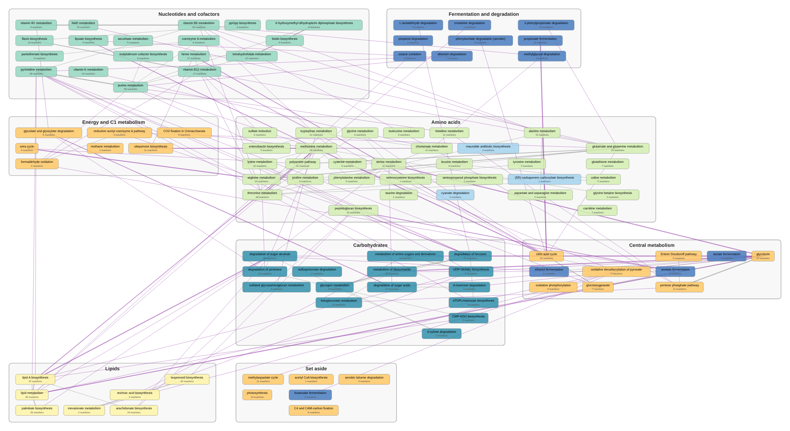

| Central map | Central map in Escher |
|---|---|
| 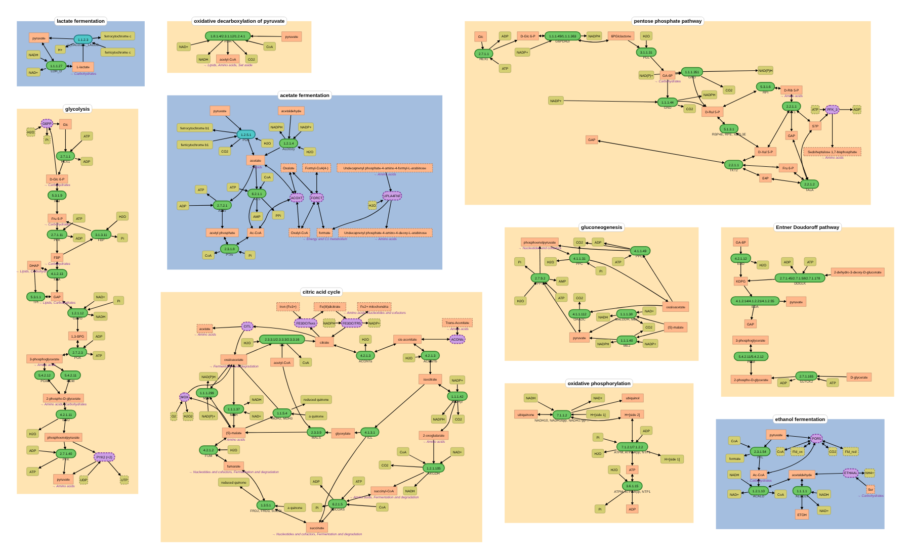 | 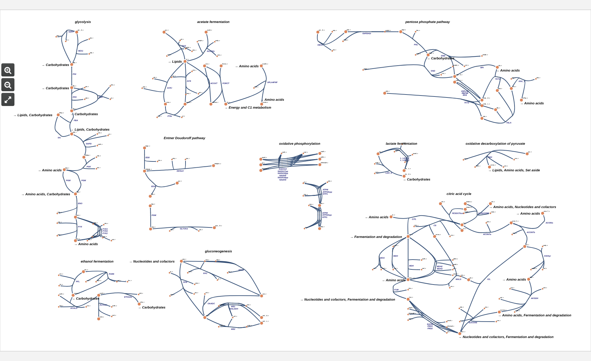 |

## 4. Evaluation

What works
- The arrangement is compact and keeps linked subsystems together (glycolysis, the pentose phosphate and
  Entner–Doudoroff pathways are next to each other; gluconeogenesis and the citric acid cycle are not near them). Annealing over sequence pairs beats the
  general tools by far because they optimise other things (stress, layers) and cannot use the fixed port positions.
- Disconnecting hubs is the most effective single measure (crossings 449 → 173 with the same annealing) and loses
  little: their nodes stay in every subsystem, marked.
- The subsystems remain recognisable BRENDA drawings, without the unused 58% of enzyme nodes; the arrows show the
  directions of the model.
- Rules A–C (1.1) remove 17 subsystems that only repeat reactions drawn elsewhere (6 of them set aside on their own
  map), so the main map has 59 fewer duplicate Escher reactions, without losing a reaction.
- Step 3b removes 78% of the crossings inside the subsystems with added reactions (1,112 → 245); in 37 of the 59
  subsystems the BRENDA drawing stays as it is (current drawing, `spring`, `fdp`).
- Completion adds 297 reactions, mostly where they belong (phospholipid/LPS reactions in lipid A, CDP-diacylglycerol
  and fatty acid subsystems; cofactor reactions; nucleotide salvage in purine/pyrimidine metabolism; e.g. `PYK2 (+2)`,
  pyruvate kinase with other nucleotides, in glycolysis).

Problems
- Added reactions are placed by drawn metabolites, not by biology: phospholipid turnover lands in "lipid A
  biosynthesis" because palmitate/palmitoleate are drawn there; 17 reactions of "Inorganic Ion Transport and
  Metabolism" (Fe³⁺-siderophore reductases, FMN-dependent monooxygenases) in vitamin B12 metabolism; the Fe³⁺-dicitrate
  reactions `FE3DCITexs` (extracellular) and `FE3DCITR5` in the citric acid cycle (citrate is drawn there);
  `FBA3` (sedoheptulose-1,7-bisphosphate aldolase), drawn only in the set-aside "photosynthesis", is added to
  chorismate metabolism (where E4P and DHAP are drawn), not to the pentose phosphate pathway.
- 58 periplasmic reactions are drawn like cytosolic ones (the BRENDA map has no compartments).
- Subsystems with many added reactions stay busy where many reactions share a metabolite (palmitate and palmitoleate
  in lipid A biosynthesis); `dot` and `neato` (22 subsystems) change the BRENDA drawing, and step 3b makes the
  subsystem drawings 9% larger. Condensation adds 11% (main) / 29% (all) crossings inside subsystems.
- Generic map metabolites match many model variants (via generic KEGG compounds); the grouping of variants hides
  that, the label shows `(+k)`.
- 83 inter-pathway links still pass through other boxes (straight lines).
- Reactions on several nodes are drawn several times (BRENDA draws some steps in several subsystems); CNApy shows one
  box per reaction (the first node is used).
- Not drawn: 597 non-transport reactions (e.g. many glycerophospholipid chain-length variants, murein biosynthesis,
  where no metabolite of the map matches) and all 768 transporters.

## 5. Escher export

`draft_map.escher.json` (Escher schema 1-0-0, coordinates × 2.5) leaves out the inter-pathway links and the subsystem
boxes; the subsystem names are text labels (`--escher-no-labels` drops them). Each model reaction of an enzyme node is
an Escher reaction with a midmarker at the node and a multimarker for its substrates and one for its products. Drawn
main metabolites are primary nodes, matched cofactors secondary nodes; metabolites that are not drawn get secondary
nodes next to the reaction; protons are not drawn (they stay in the stoichiometry). There is one Escher node per drawn
node and compartment-specific model metabolite, at the position of the drawn node in the SVG. Metabolite nodes that
continue on other maps (`--split`, set-aside map) get a text label "→ map names".

The reactions are drawn as Escher's builder draws new reactions, with straight reaction axes and curved branches
(`curve_reactions` in `escher.py`, a post-processing step of the Escher map; the multimarker placement follows
[BioEMMA](https://pypi.org/project/bioemma/), which converts KEGG maps to Escher maps):

- **Axis:** a straight line through the midmarker, along the difference of the directions from the midmarker to the
  centre of the primary products and to the centre of the primary substrates. A reaction with its substrates above
  and its products below runs vertically; one with both above it runs horizontally and is drawn U-shaped.
- **Multimarkers** on the axis, 30% of the way to the centre of their metabolites (20–80 units from the midmarker).
- **Branches:** the segments between a multimarker and its metabolites are cubic Bezier curves. The control point at
  the multimarker lies on the axis (40% of the segment length times the cosine of its angle to the axis, at least a
  quarter of that, at most 100 units), the one at the metabolite 35% of the way from it to the first. A branch leaves
  the reaction along its axis and bends towards its metabolite; a metabolite on the axis gets a straight segment.
- **Several model reactions of an enzyme node** (e.g. the NADH dehydrogenases, PYK2–4): side by side in lanes 25
  units apart, perpendicular to their common axis, ordered by the metabolites they do not share; their labels are
  stacked next to the lanes (right of steep axes, below flat ones).
- **Metabolites that are not drawn** go next to the multimarker of their side, alternately left and right of the axis
  (outwards for lanes).
- **"→ map" labels** (Escher draws text labels at 50 px): right of, below, left of or above their node, whichever
  covers the fewest points of segments, nodes and labels.

The metabolite nodes stay where they are, so the Escher map has the layout of the SVG. In Escher's builder, the
control points can be moved like those of reactions added there. `--escher-straight` gives the previous drawing:
straight segments, multimarkers 25 units from the midmarker towards their metabolites, further reactions of an
enzyme node below the first.

| Straight segments (`--escher-straight`) | Straight axes, curved branches (default) |
|---|---|
| 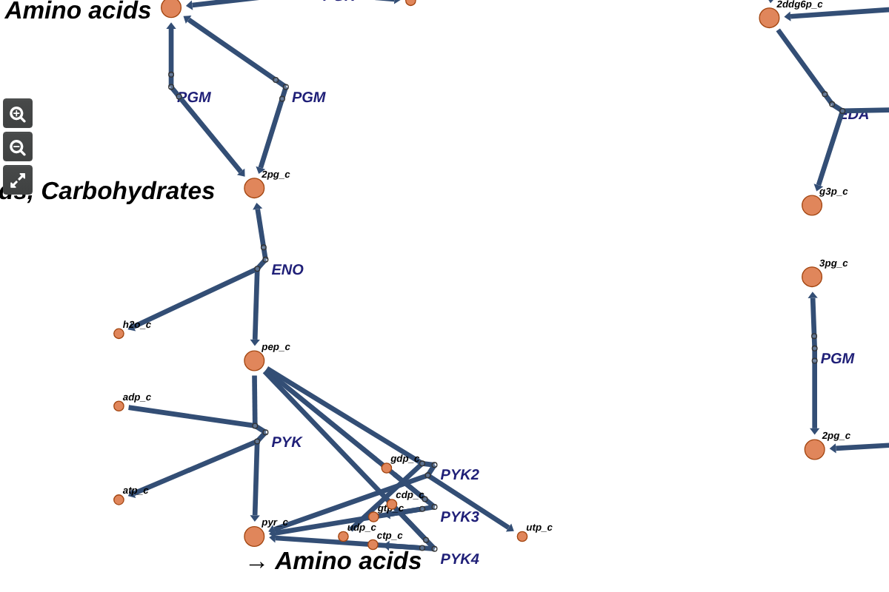 | 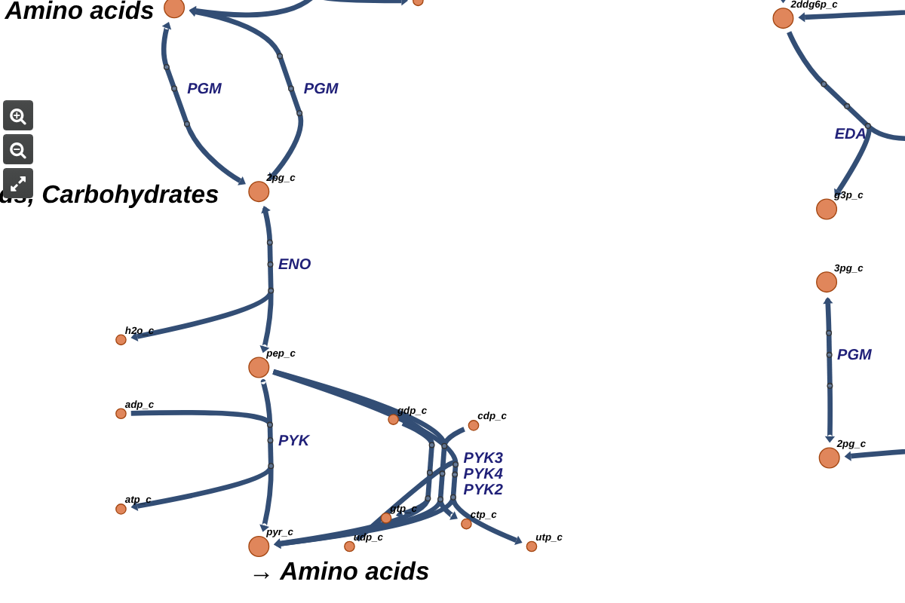 |

iML1515: 1,124 Escher reactions (1,010 model reactions; reactions on several nodes are drawn several times),
6,544 nodes, 98 text labels, 4,571 curved segments; the set-aside map `set_aside.escher.json` has 45 Escher
reactions (38 model reactions). `escher.validate.validate_map` (escher 1.7.3; schema and consistency of segments,
stoichiometry, genes) passes; Escher 1.7.3 loads it with `iML1515.json` and finds all reactions and metabolites in
the model. The same holds for the set-aside map and the maps of `--split`.

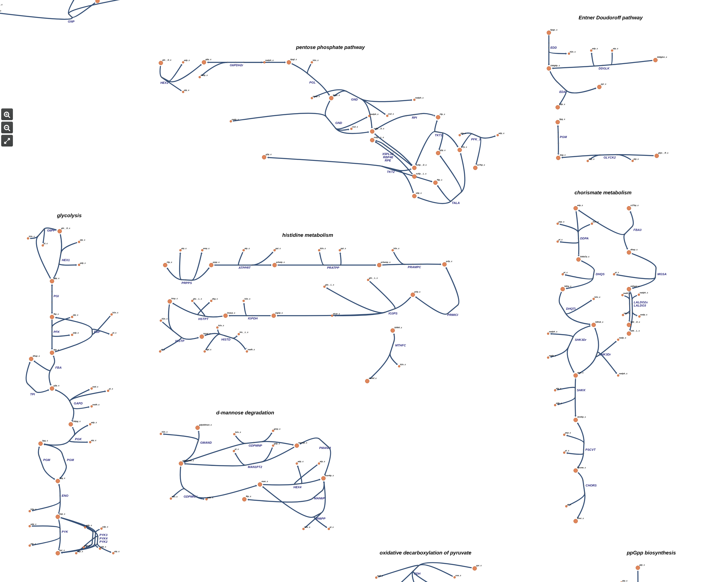

## 6. Next steps

1. Route inter-pathway links around boxes (libavoid or ELK orthogonal routing) and draw them in the Escher map as
   needed.
2. Completion: compartment handling (restrict to the cytosol or add a "periplasm" subsystem), a target-subsystem score
   that also uses the model subsystem, optional new subsystems for groups of added reactions without a good BRENDA
   subsystem (e.g. murein, membrane lipids).
3. Inside subsystems: draw the bends of `dot` layouts (in the SVG and as Bezier control points in Escher), and constraints that
   keep added reactions near the BRENDA nodes they connect (e.g. WebCola).
4. Weights of the annealing as options; keeping the colour groups (category regions) of the BRENDA map together.
5. Semantic zooming in a viewer: collapse subsystems into the boxes of the overview and re-pack the maps with the
   same sequence pairs, which keeps the relative positions.
6. A command of the `ecmapper` CLI; runs on the models of [BRENDA_MAP_EVALUATION.md](BRENDA_MAP_EVALUATION.md).
